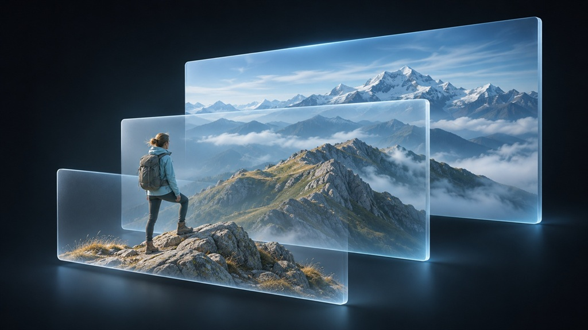
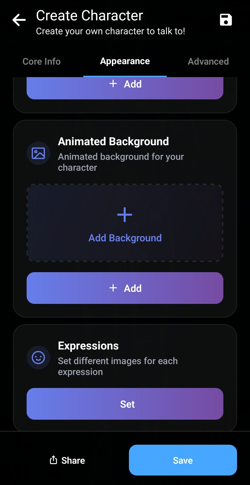
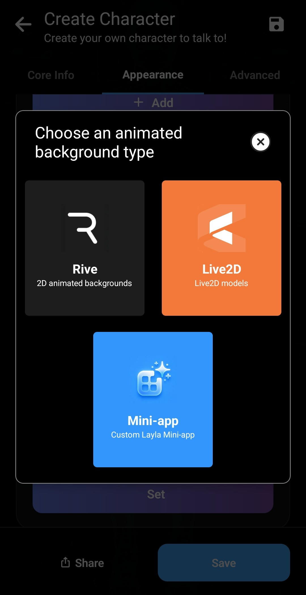
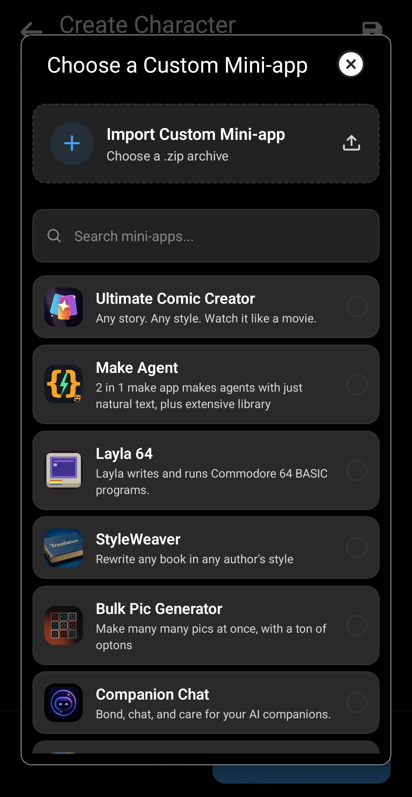
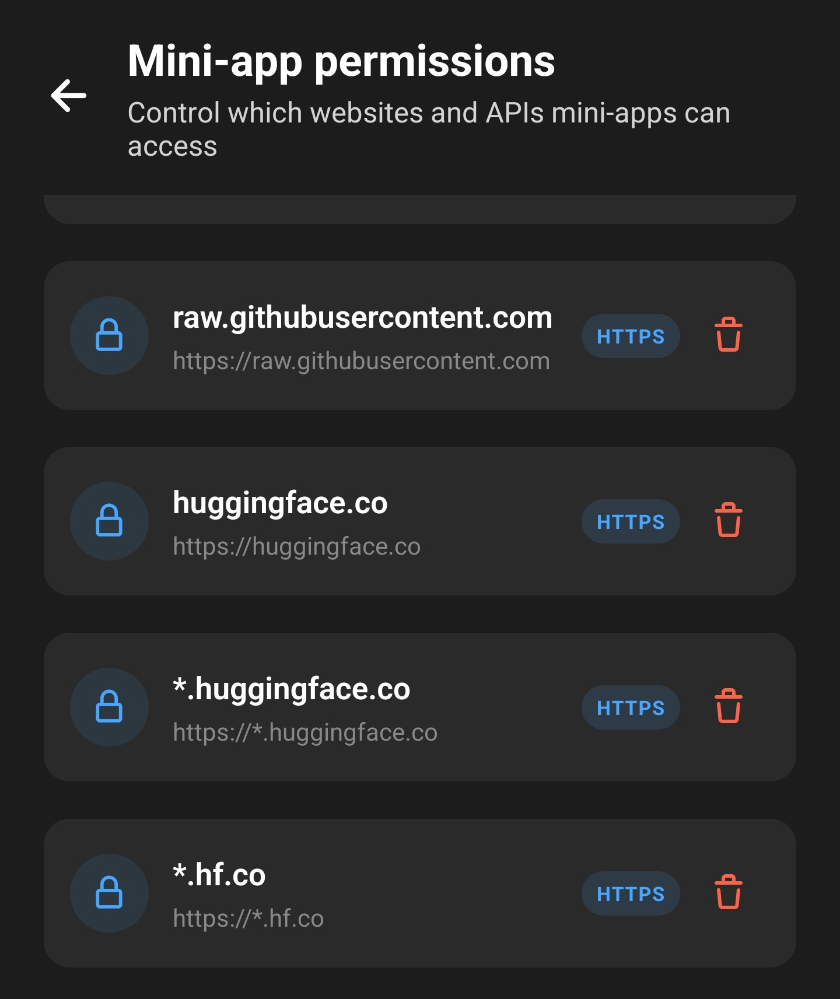

# Parallax: 2.5D Photo to Animated Background, On Device

A Layla mini-app that turns a single photo into a 2.5D parallax scene with depth, in the style of iOS Spatial Scenes. Pick a photo with one clear subject. Parallax cuts the character out, estimates a depth map, and builds a scene that moves as you tilt your phone or move your pointer. Save the result as its own mini-app and use it as a Layla character's animated background.

Background removal and depth estimation run on your device with WebGPU. The AI models are downloaded once, and your photos never leave the device. No cloud, no account, no subscription.

**Open it in Layla:** https://apps.layla-cloud.com/app/parallax

<p align="center">
  
</p>

## Features

- **One photo in, 2.5D scene out.** No separate depth map, mask or inpainted background needed.
- **AI background removal** with the [withoutBG](https://huggingface.co/withoutbg/withoutbg-openweights-onnx) open-weights matting model, so hair and soft edges keep a clean alpha matte.
- **AI depth estimation** with [Depth Anything V2](https://huggingface.co/onnx-community/depth-anything-v2-small), run on the full photo so the background gets depth too.
- **Tilt, pointer or drift motion.** Phones and tablets with a motion sensor default to tilt.
- **Presets and fine control.** Subtle, Balanced and Dramatic presets, plus sliders for depth strength, camera travel, focus depth and zoom. Inspect the front layer, back layer and depth map on their own.
- **Export as a Layla mini-app.** Save scene writes a `.zip` that Layla imports as a character's animated background.
- **Private and offline after setup.** Inference runs in the browser with ONNX Runtime Web (WebGPU, with a WASM fallback). Nothing is uploaded.
- **Bundled samples** (Layla, Yor and Iron Man) to try it before using your own photo.

## How to use

1. **Character.** Choose a photo, drop one onto the page, or pick a sample. Tap **Remove background** to cut out the subject. The first run downloads the withoutBG model.
2. **Depth.** Estimate the depth map. The first run downloads Depth Anything V2 Small.
3. **Configure.** Pick a preset or tune the motion, and choose what drives it: tilt, pointer or a slow drift.
4. **Result.** Preview the finished scene and tap **Save scene** to export it as a Layla mini-app.

### Use your scene as a character's animated background in Layla

1. Open your character in Layla, go to the **Appearance** tab, and tap **Add** under **Animated Background**.
2. Choose the background type **Mini-app**.
3. Tap **Import Custom Mini-app** and pick the `.zip` you saved.
4. Save the character and start chatting. The character sits in front of the scene, which moves as you look around.

<p>
  
  
  
</p>

### If the model download is blocked

Parallax downloads its models from Hugging Face. If Layla's mini-app permissions block those sites, open Layla's **Mini-app Settings** and add `huggingface.co`, `*.huggingface.co` and `*.hf.co` under **Mini-app permissions**. Parallax detects this and shows the same instructions.

<p>
  
</p>

## How it works

- **Background removal** (`src/ml/withoutbg/`) runs the withoutBG router backbone and its matting branch in a Web Worker. The cutout is the original photo with the matte as alpha.
- **Depth estimation** (`src/ml/depth/`) runs Depth Anything V2 Small (fp32 ONNX) and produces 16-bit inverse depth, white = near. Its output matches `scripts/Depth-Anything-V2/depth_test.py` to within 2/65535.
- **Model storage** (`src/ml/modelStore.ts`, `src/ml/appFolderStore.ts`): files are checked against their SHA-256 and kept in the Layla mini-app folder when running in Layla, or in the browser's Origin Private File System otherwise, so each model downloads once.
- **Layer depth** (`src/parallax/prepare.ts`) derives a depth map for each layer from the single depth map, at a working size of up to 512 px:
  - **Background depth**: the character region (dilated) is removed and filled from the surrounding depth using push-pull, so the background doesn't bulge forward where the character used to be.
  - **Character depth**: the eroded interior is extended outward past the silhouette, so the edges move as one piece instead of smearing toward the background.
- **Rendering** (`src/parallax/ParallaxViewer.ts`) turns each layer into a dense grid mesh in Three.js. Each vertex is placed along the ray from the centered camera through its pixel, so the view at rest matches the source image exactly. The camera moves with tilt or the pointer and looks at the focus depth. Layers are drawn in order (background, then character) with a depth clear between them, so the character is always drawn over the background.
- **Export** (`src/export/sceneExport.ts`) packages the original photo, the cutout, the 16-bit depth map, an icon, a preview and a standalone player (`src/player/`, Three.js included) into a mini-app zip with the scene settings baked in.

The Layla integration uses [`@layla-network/sdk`](https://www.npmjs.com/package/@layla-network/sdk) for saving files to the mini-app folder. Listing metadata for the Layla mini-app store lives in [`public/app.json`](./public/app.json).

## Development

Built with React 19, TypeScript, Vite 8, Three.js and ONNX Runtime Web.

```bash
npm install
npm run dev
```

Add `?layla-mock` to the dev URL to simulate running inside Layla. The mini-app folder is then stood in for by `.layla-dev/app-folder/`.

Type-check, build and lint with:

```bash
npm run build
npm run lint
```

`npm run build` writes the mini-app folder to `dist/`, with `app.json` and its images from `public/`.

`scripts/` holds the Python reference tooling for [withoutBG](./scripts/withoutBG/README.md) and [Depth Anything V2](./scripts/Depth-Anything-V2/README.md) used to check the in-browser pipelines.

## Download Layla

Parallax runs in [Layla](https://www.layla-network.ai/), an offline AI assistant and AI companion app that runs language models privately on your phone. Open Parallax from the Layla mini-app store:

**https://apps.layla-cloud.com/app/parallax**

<p>
  <a href="https://play.google.com/store/apps/details?id=com.layla">
    
  </a>
  &nbsp;&nbsp;
  <a href="https://apps.apple.com/us/app/layla/id6456886656">
    
  </a>
</p>

Visit the official Layla website: https://www.layla-network.ai/

## Keywords

2.5D photo, parallax photo, 3D photo effect, depth effect wallpaper, spatial photo, iOS Spatial Scenes alternative, photo to 3D, live wallpaper from photo, animated background, AI background remover, background removal, AI cutout, image matting, depth map, monocular depth estimation, Depth Anything V2, withoutBG, WebGPU, ONNX Runtime Web, Three.js, on-device AI, offline AI, private AI, local AI, no cloud, AI companion, AI character background, Layla, Layla mini-app, offline AI assistant for Android, AI app for iPhone.
